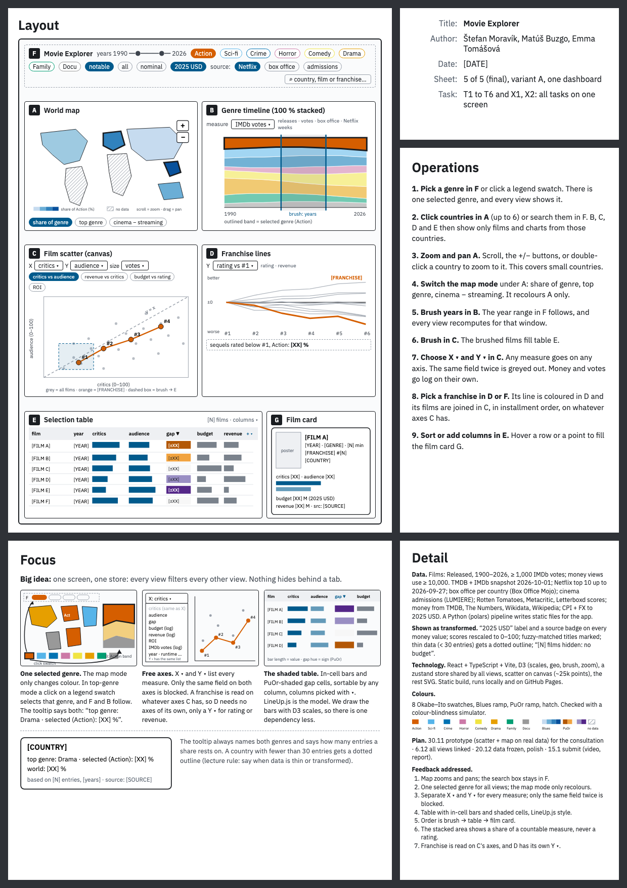
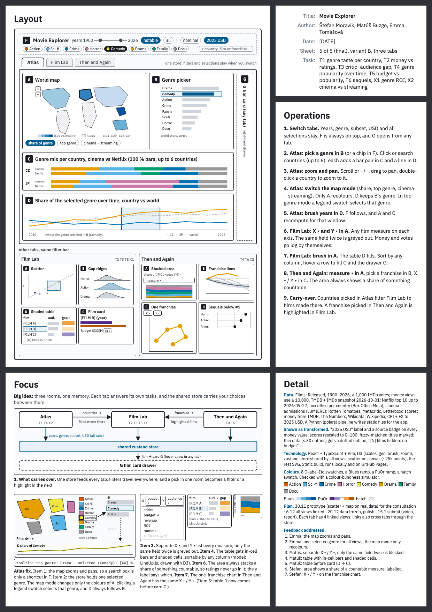
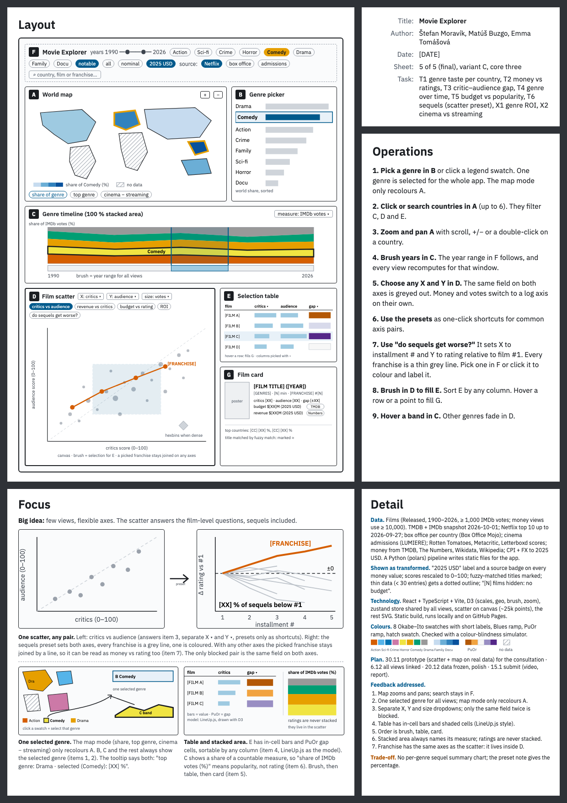

# Sheet 5 canvas

Three alternative boards for HW4 (Five Design Sheets, sheet 5: the final
realization design). Each one merges sheets 2–4 and answers the HW3 feedback.
The team picks one, and Emma redraws it by hand on the course template (Layout,
Focus, Operations, Detail and the info box). The date and every number on the
boards are placeholders.

| Variant | Design | Big idea |
|---|---|---|
| A | One dashboard | All views on one screen: map, genre timeline, film scatter, franchise lines, table and film card |
| B | Three tabs | Atlas, Film Lab and Then and Again as tabs that share one filter bar and store |
| C | Core three | Map, genre timeline and film scatter. Franchises become a scatter preset |

## How each board answers the HW3 feedback

| Feedback | Answer on every board |
|---|---|
| Emma: the map could just zoom instead of having a search box | The map zooms and pans. The search box stays for small countries |
| Emma: in top-genre mode, which genre does D show? | There is one selected genre in the store. The map mode only recolours the map, and clicking a legend swatch selects that genre |
| Matúš: separate X and Y? Are any combinations nonsensical? | X ▾ and Y ▾ take any film measure. Only "same field twice" is blocked. Presets stay as shortcuts |
| Matúš: conditionally formatted table, LineUp.js | In-cell bars and shaded cells in the LineUp.js style, drawn with D3 |
| Matúš: swap D and C, since the workflow is D → C | Brush, then table, then film card |
| Štefan: what does the stacked area show for IMDb votes? | The share of votes, which measures popularity, not rating. Ratings are never stacked |
| Štefan: customisable axes on the franchise chart | The franchise is drawn on the scatter's free axes (A, C) or gets its own X ▾ Y ▾ (B) |

The PNGs show on GitHub. The HTML files open in any browser.

## Variant A. One dashboard

## Variant B. Three tabs

## Variant C. Core three

