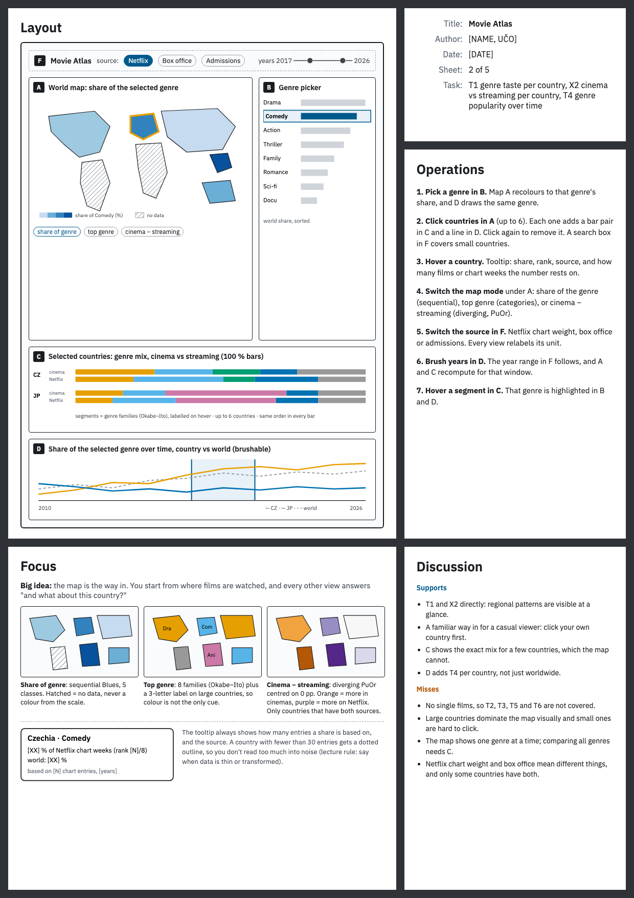
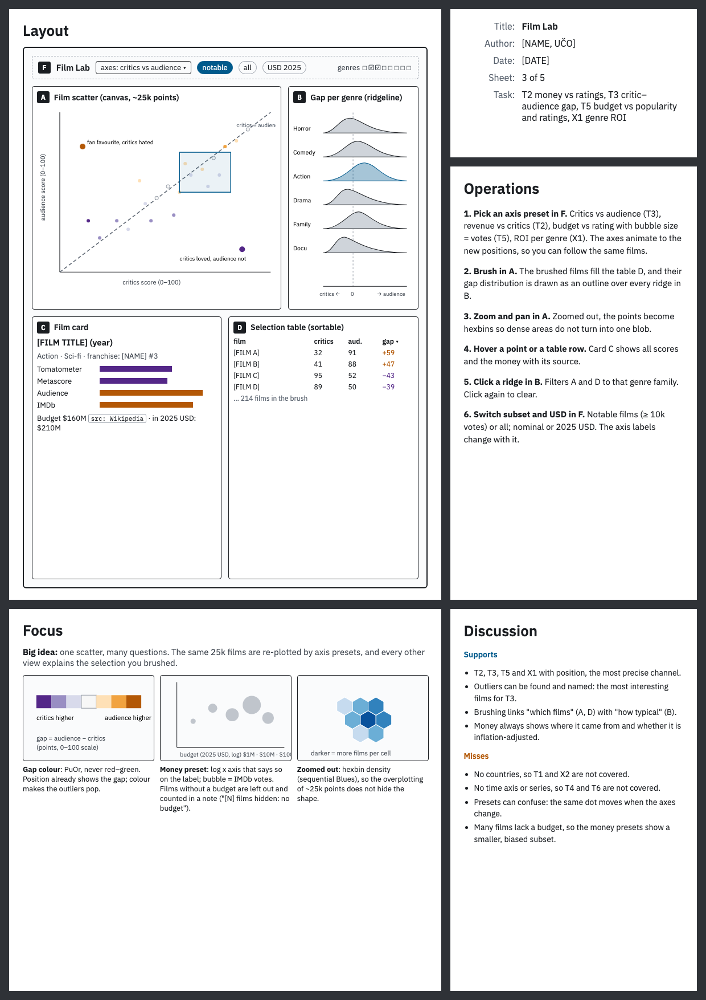
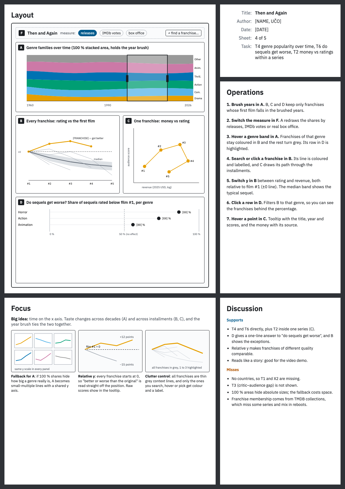

# Sheets 2–4 canvas

Three alternative designs for HW3 (Five Design Sheets, sheets 2–4), due Mon
2.11.2026. Each board follows the course template: Layout, Focus,
Operations, Discussion and the info box. They build on the sheet 1 picks (D10
in `docs/decisions.md`). Use them as the reference when drawing the sheets on
paper. Author, UČO, date and every number on the boards are placeholders.

| Sheet | Design | Big idea | Tasks |
|---|---|---|---|
| 2 | Movie Atlas | The map is the way in | T1, X2, T4 |
| 3 | Film Lab | One scatter, many questions | T2, T3, T5, X1 |
| 4 | Then and Again | Time on the x axis: decades and installments | T4, T6, T2 |

The PNGs below show on GitHub. The HTML files open in any browser.

## Sheet 2. Movie Atlas

## Sheet 3. Film Lab

## Sheet 4. Then and Again

